# Event Driven Architecture avec Kafka et Spring Cloud Stream

Activité pratique N°3 du cours **Systèmes Distribués et DevOps 2026**, encadré par M. Mohamed YOUSSFI.

Une application Spring Boot qui publie, consomme, fournit et analyse en temps réel des événements `PageEvent` à travers Apache Kafka, avec un tableau de bord web qui se met à jour en direct.

## Architecture

```
                      ┌──────────────────────── Spring Boot (Spring Cloud Stream) ────────────────────────┐
                      │                                                                                   │
 GET /publish ───────▶│ REST Controller ──▶ topic T2 ──▶ Consumer (affiche dans la console)               │
                      │                                                                                   │
                      │ Supplier (1 événement/seconde) ──▶ topic T3 ──▶ Kafka Streams (count par page)    │
                      │                                                      │                            │
                      │                                                      ▼                            │
 GET /analytics ◀─────│ Flux SSE ◀──────────── store de comptage ◀── topic T4 (clé=page, valeur=Long)     │
                      └───────────────────────────────────────────────────────────────────────────────────┘
                                         │
                                         ▼
                              index.html (graphique temps réel)
```

| Topic | Rôle |
|-------|------|
| `R2`  | Tests manuels avec les outils console de Kafka |
| `T2`  | Événements publiés via l'API REST, lus par le Consumer |
| `T3`  | Événements générés automatiquement par le Supplier |
| `T4`  | Résultat de l'analyse : nombre de visites par page |

Modèle d'événement :

```json
{ "name": "P1", "user": "U1", "date": "2026-11-10T00:07:48.178Z", "duration": 728 }
```

## Technologies

- Apache Kafka et Zookeeper (Confluent 7.3.0, via Docker Compose)
- Spring Boot, Spring Cloud Stream, Kafka Streams
- Frontend : HTML + graphique temps réel (`index.html`)

## Lancer le projet

**Prérequis :** Docker Desktop, JDK 17+, Maven.

1. Démarrer Kafka et Zookeeper :
   ```bash
   docker compose up -d
   docker ps        # broker et zookeeper doivent être "Up"
   ```
2. Lancer l'application `KafkaSpringCloudStreamApplication` depuis IntelliJ, ou avec `mvn spring-boot:run`.
3. Ouvrir :
    - http://localhost:8080/publish?name=P1&topic=T2 : publie un événement
    - http://localhost:8080/analytics : flux brut des statistiques
    - http://localhost:8080/index.html : tableau de bord

## Étape 1 : Vérifier Kafka avec les outils console

Après `docker ps` (broker et zookeeper actifs), on teste Kafka sans aucun code.

Producteur :
```bash
docker exec -it broker kafka-console-producer --bootstrap-server broker:9092 --topic R2
```
Consommateur (`--from-beginning` pour relire tout l'historique) :
```bash
docker exec -it broker kafka-console-consumer --bootstrap-server broker:9092 --topic R2 --from-beginning
```

| Producteur | Consommateur |
|---|---|
| 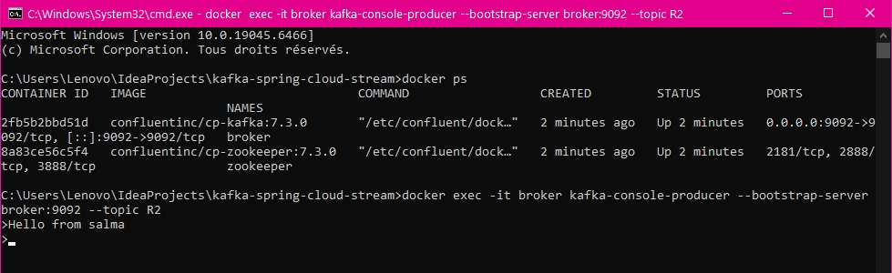 | 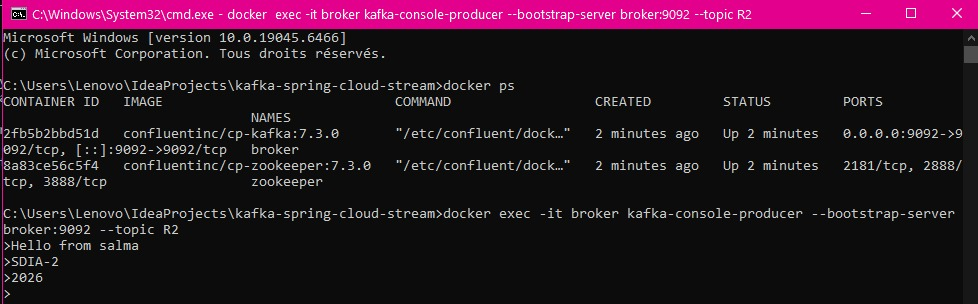 |

> Le message `LEADER_NOT_AVAILABLE` au premier lancement est normal : le topic est créé automatiquement et le leader de la partition n'est pas encore élu. Le message arrive juste après.

Avec `--from-beginning`, les 3 messages envoyés (`Hello from salma`, `SDIA-2`, `2026`) sont bien relus :

| Envoi de plusieurs messages | Relecture depuis le début |
|---|---|
| 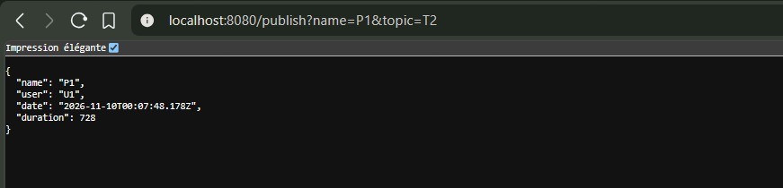 | 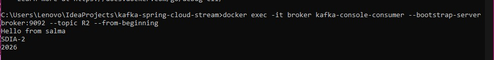 |

## Étape 2 : Publier et consommer avec Spring Cloud Stream

Un contrôleur REST publie un `PageEvent` aléatoire (utilisateur U1 ou U2, durée aléatoire) sur le topic demandé :

```
GET /publish?name=P1&topic=T2
```

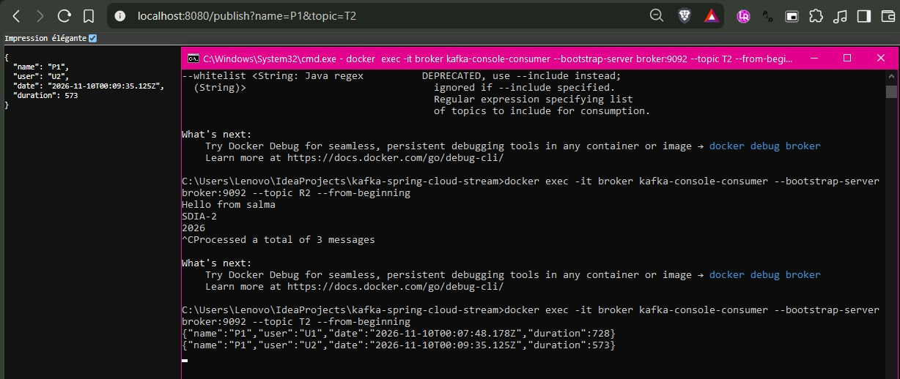

Le même message est visible dans le consommateur console sur `T2`, et dans les logs de l'application via la fonction Consumer :

| Consumer console (T2) | Logs Spring Boot |
|---|---|
| 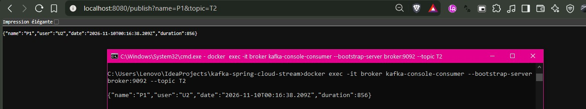 | 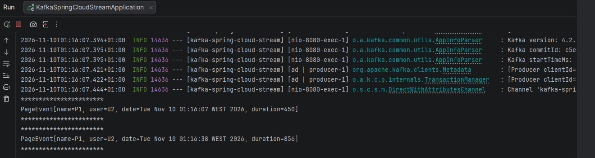 |

## Étape 3 : Supplier, génération automatique

Un `Supplier<PageEvent>` produit un événement par seconde sur `T3` (pages P1 et P2, utilisateurs U1 et U2) :

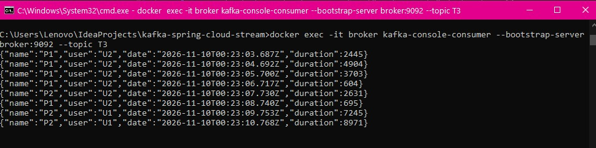

## Étape 4 : Analyse temps réel avec Kafka Streams

Une fonction Kafka Streams lit `T3`, regroupe par nom de page et compte les visites. Le résultat (clé = page, valeur = `Long`) est écrit dans `T4`.

Vérification avec les désérialiseurs adaptés :

```bash
docker exec -it broker kafka-console-consumer --bootstrap-server broker:9092 --topic T4 \
  --property print.key=true --property print.value=true \
  --property key.deserializer=org.apache.kafka.common.serialization.StringDeserializer \
  --property value.deserializer=org.apache.kafka.common.serialization.LongDeserializer
```

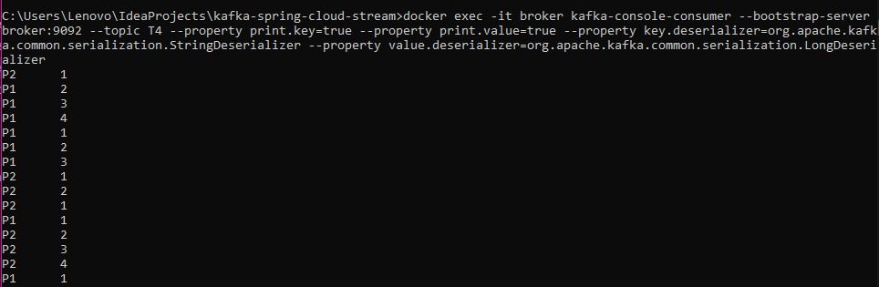

## Étape 5 : Exposition et visualisation

L'endpoint `/analytics` diffuse les compteurs en continu (Server-Sent Events) :

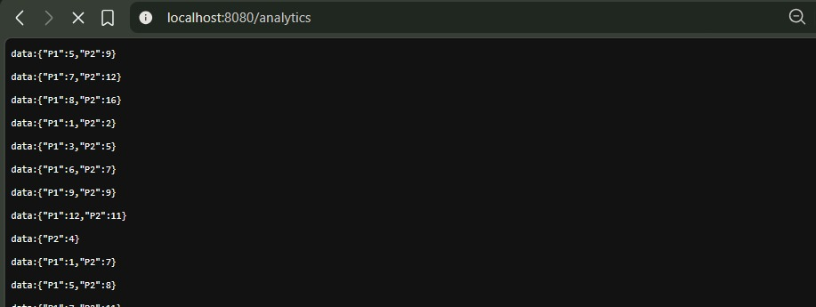

La page `index.html` consomme ce flux et trace une courbe par page (rouge et verte) en temps réel :

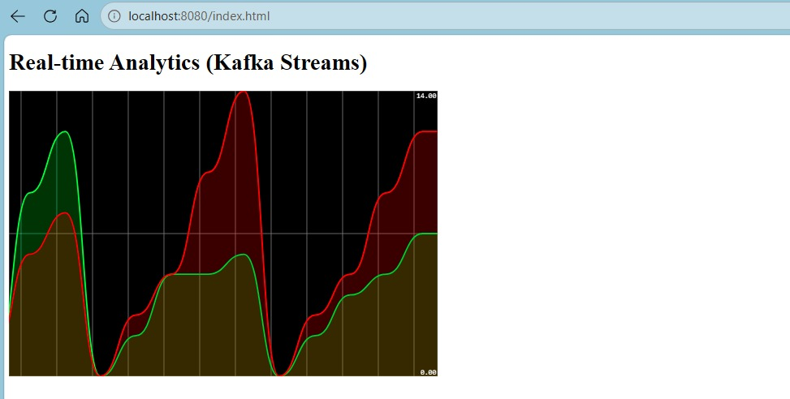

## Interface Utilisateur (Frontend)

Actuellement, les résultats du Stream Data Analytics sont visibles de trois façons :

- la console (consommateurs Kafka et logs Spring Boot) ;
- l'endpoint REST `/analytics` (flux brut) ;
- une page HTML simple, `index.html`, qui affiche un graphique en temps réel.

> **Note importante :** une application frontend complète (en Angular ou React) sera ajoutée ultérieurement pour interagir avec cette application. Elle permettra une meilleure visualisation des graphiques en temps réel et un contrôle interactif du système.

## Structure du projet

```
kafka-spring-cloud-stream/
├── docker-compose.yml              # Zookeeper + Kafka broker
├── src/main/java/.../              # Contrôleur REST, PageEvent, fonctions Consumer / Supplier / Kafka Streams
├── src/main/resources/
│   ├── application.properties      # Bindings Spring Cloud Stream
│   └── static/index.html           # Tableau de bord temps réel
└── screenshots/                    # Captures de validation
```

## Auteur

Salma Majri, SDIA-2, 2026